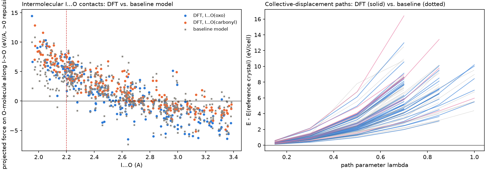

# IBX Solubility and Solid-State Machine-Learning Potentials

> Ongoing research project. Results and code are under active development and are not final.

## Overview

This project studies the solid-state and solution-relevant molecular interactions of
2-iodoxybenzoic acid (IBX), a hypervalent-iodine oxidant, by combining high-level
electronic-structure calculations, molecular simulation and machine-learning interatomic
potentials (MLIPs). The immediate goal is a robust, periodic potential for crystalline IBX that
reproduces the reference potential-energy surface well enough for long molecular-dynamics (MD)
simulations; the longer-term goal is to use such potentials for solubility, aggregation and
self-association studies of IBX and its derivatives.

## Scientific goals

- Accurate crystalline IBX energetics, forces and stresses.
- Intermolecular cohesion, including hypervalent-iodine (I···O) secondary bonding, hydrogen bonding
  and short intermolecular contacts.
- Correct strain / stress response of the crystal.
- Robust, energy-conserving molecular dynamics in periodic cells and supercells.
- Eventual application to solubility, aggregation / self-association and IBX derivatives.

## Reference electronic structure

The reference level for the current potential-development campaign is periodic **SCAN-D3(BJ)**
density-functional theory (CP2K; GPW, TZV-quality MOLOPT basis sets, GTH-SCAN pseudopotentials,
Monkhorst–Pack k-point sampling of the 68-atom unit cell, analytical stress). Supercell
calculations use folded k-point sets equivalent to the unit-cell sampling.

## Model-development strategy

The project has explored, roughly in order:

- physics-guided, modular delta-learning models on top of a pretrained baseline potential;
- baseline-plus-correction formulations with explicit short-range contact corrections;
- periodic, local machine-learning potentials trained directly on SCAN-D3(BJ);
- direct equivariant message-passing models (MACE-type);
- modular models that separate intramolecular and intermolecular contributions;
- short-range safeguards (screened nuclear repulsion and an extrapolation guard below the
  sampled data range) that are exactly inactive on all reference data;
- active learning and ab initio MD (AIMD) for data generation.

See [`docs/MODEL_DEVELOPMENT.md`](docs/MODEL_DEVELOPMENT.md) for the two current model families.

## Data generation

- DFT single points on crystal distortions (rigid-body, intramolecular, phonon-like);
- strain and cell perturbations, including an equation-of-state family;
- intermolecular I···O contact configurations spanning the compressed and secondary-bonding regimes;
- independent "false-basin" probes along collective molecular displacement paths;
- supercell configurations for transferability checks;
- AIMD at 250–450 K with independent velocity seeds;
- committee-based active learning (model disagreement, short-contact force uncertainty, relaxation
  instability precursors, structural diversity).

All data are split by complete source groups (trajectory, contact anchor, distortion family,
active-learning episode) rather than by individual frames.

## Validation

- energy, force and stress errors on independent, source-separated development sets;
- periodic invariance (atom re-wrapping, molecular lattice translations, equivalent cell choices,
  supercells);
- recovery of the physical crystal basin from independent perturbed starting structures;
- molecular (covalent) integrity;
- NVE energy conservation and NVT stability at several temperatures;
- supercell consistency.

Model selection is based on these physics gates, not on training error alone.

## Current progress (snapshot)

- More than 14,000 SCAN-D3(BJ)-labelled structures are in the current development dataset;
  active learning and AIMD substantially expanded coverage of thermal, compressed and distorted
  configurations.
- Earlier baseline/delta formulations were useful diagnostically but proved inadequate for robust
  production MD (e.g. supercell inconsistency and spurious low-energy minima under relaxation).
- Rebuilt periodic local models reach roughly sub-meV/atom energy errors and ~0.08 eV/Å force
  errors on development validation, with stress errors of ~0.1 GPa.
- Two model families remain under comparison: a direct equivariant model (Branch A) and a modular
  intra/intermolecular model (Branch B). Both show much stronger basin recovery and MD stability than
  the earlier architecture.
- A new model generation is being trained and evaluated on the expanded dataset.
- Final independent (blind) validation has not yet been performed.

See [`docs/PROGRESS.md`](docs/PROGRESS.md).



*Left: projected force between molecules along I···O contacts (DFT vs. an earlier baseline);
all sampled contacts shorter than 2.20 Å are repulsive. Right: DFT energies along independent
collective-displacement paths rise monotonically from the reference crystal.*

## Roadmap

- complete validation of the current model generation;
- further active learning where diagnostics require it;
- longer pre-production MD validation;
- final independent validation;
- extension toward IBX derivatives;
- solid-state / solution free-energy and association studies relevant to solubility.

## Repository layout

```
docs/      project overview, methods, model development, progress
src/       selected reusable code (model definitions, geometry utilities, invariance tests)
figures/   representative figures
```

The full research workspace, raw DFT data and trained models are not included.

## Requirements

Python ≥ 3.10, PyTorch, [MACE](https://github.com/ACEsuit/mace) (0.3.x), e3nn, ASE, NumPy, SciPy
(see `requirements.txt`).
